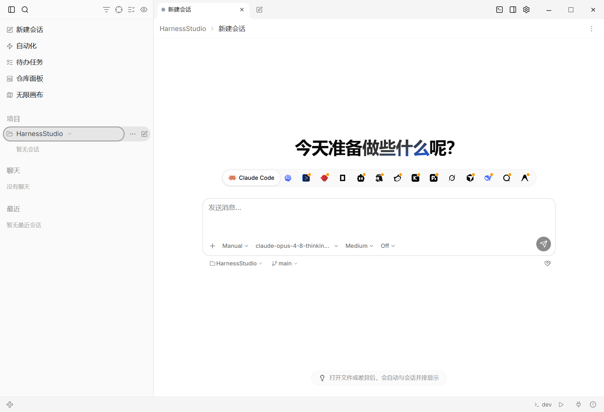
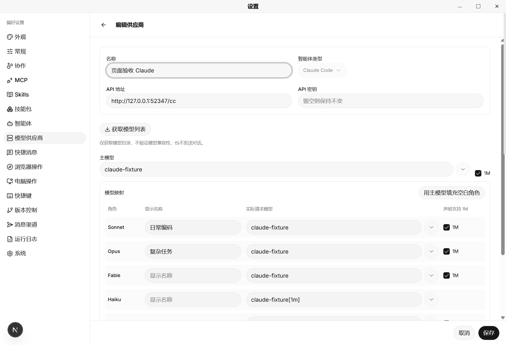

<div align="center">


# Harness Studio

**把智能体、项目和工具放进同一个桌面工作台。**

多智能体协作 · 本地项目 · 模型供应商 · MCP 与 Skills

版本 0.1.0

[功能介绍](#能做什么) · [开始使用](#开始使用) · [开发与构建](#开发与构建)

</div>



Harness Studio 是一个围绕本地项目构建的多智能体桌面工作台。
你可以在同一个窗口中选择智能体、管理项目与会话、查看文件和代码差异，
也可以将子任务交给其他智能体协作完成。

项目使用 Tauri 2 和 Rust 构建桌面应用，前端采用 Next.js、React 和 TypeScript。

## 能做什么

| 功能             | 使用方式                                                                                                  |
| ---------------- | --------------------------------------------------------------------------------------------------------- |
| 多智能体工作区   | 在统一界面中使用 Claude Code、Codex CLI、Gemini CLI、OpenCode、Kimi Code 等智能体，按任务选择合适的工具。 |
| 智能体协作       | 在对话中引用其他智能体、委派子任务，并跟踪子会话的执行过程；结合 Git worktree 并行处理项目工作。          |
| 项目与会话管理   | 围绕项目组织会话，在对话旁打开文件、查看差异、使用终端，并通过仓库面板查看版本控制信息。                  |
| 模型供应商配置   | 为 Claude Code、Codex 和 Gemini 配置接口与模型，获取、搜索模型目录，也可手动填写模型 ID。                 |
| MCP 与 Skills    | 管理 MCP、Skills 和技能包，为不同智能体启用所需工具。                                                     |
| 任务与自动化     | 使用待办任务跟踪工作，或把重复提示词保存为定时自动化。                                                    |
| 浏览器与电脑操作 | 在桌面工作流中使用内置浏览器，并按配置向智能体开放浏览器和电脑操作能力。                                  |
| 文档与画布       | 在会话旁预览文件，使用无限画布组织内容；办公文档工具需要另外安装相应依赖。                                |

智能体的安装、认证方式和工具能力各有不同，具体可用项以设置页及对应智能体为准。

## 模型供应商与 Claude 映射

在「设置 → 模型供应商」中集中配置接口地址、API 密钥和模型。
模型目录支持获取、搜索与选择；对于未返回目录的服务，也可以直接填写模型 ID。

Claude Code 支持主模型、Sonnet、Opus、Fable、Haiku 和 Subagent 映射。
选择角色模型后，显示名称为空或仍跟随旧模型 ID 时会自动填入新模型 ID；
你可以继续手动修改显示名称，已填写的自定义名称会保留。
支持的角色也可以声明 1M 上下文，实际容量仍取决于模型和接口服务。



_配图来自本项目的桌面验收窗口。供应商页使用本地测试接口和示例模型，
用于展示界面，不代表推荐的服务商或可用模型。_

## 开始使用

1. 安装本项目构建的 Windows x64 安装包，启动 **Harness Studio**。
2. 在「设置 → 智能体」中配置需要使用的智能体，按提示完成安装和认证。
3. 如需自定义接口，在「模型供应商」中配置地址、密钥和模型，再在智能体设置中选择相应供应商。
4. 添加本地项目，选择智能体和模型，创建会话并开始工作。
5. 按需启用 MCP、Skills、协作、浏览器或电脑操作工具。

目前可按下文从源码生成安装包。模型调用使用你所配置的账号或 API 服务，
项目不会附带模型账号、订阅或 API 额度。

## 开发与构建

### 环境准备

| 依赖             | 版本或要求                                                                          |
| ---------------- | ----------------------------------------------------------------------------------- |
| Node.js          | 24                                                                                  |
| pnpm             | 11.9.0，与 `package.json` 一致                                                      |
| Rust             | 1.99.0，由 `rust-toolchain.toml` 固定                                               |
| Windows 编译工具 | Visual Studio C++ Build Tools 和 Windows SDK，组件清单见 [`.vsconfig`](./.vsconfig) |
| Windows WebView  | WebView2 Runtime                                                                    |

前后端依赖分别由 `pnpm-lock.yaml` 和 `src-tauri/Cargo.lock` 锁定。

在仓库根目录执行：

```powershell
pnpm install --frozen-lockfile
pnpm desktop:dev
```

`pnpm desktop:dev` 启动完整桌面开发环境。
前端修改会热更新，Rust 修改由 Tauri 增量编译并重启主程序。
首次启动需要编译 Rust 依赖及辅助程序，后续启动会复用缓存。

仅调整前端页面时，也可以使用 `pnpm dev`；
智能体、本地文件、终端和内置浏览器等功能需要在桌面应用中验证。

### 构建 Windows 安装包

```powershell
pnpm windows:build
```

该命令会构建前端、两个独立辅助程序和 Release 主程序，并生成 NSIS 安装包：

```text
src-tauri/target/release/bundle/nsis/harness studio_0.1.0_x64-setup.exe
```

如果只需重新打包已经更新的 Release 产物，可以运行 `pnpm windows:bundle`。
该命令不会编译修改后的代码。

### 日常开发说明

- 开发版使用独立的 `harness-studio-dev.db`；智能体自身的本地配置仍与正式版共享。
- 修改 MCP、电脑操作或辅助程序共享的 Rust 代码后，应重新启动 `pnpm desktop:dev`，让辅助程序重新构建。
- 应用图标可通过 `pnpm icons:generate` 重新生成，设计源文件和说明见 [图标资源说明](./src-tauri/icons/README.md)。
